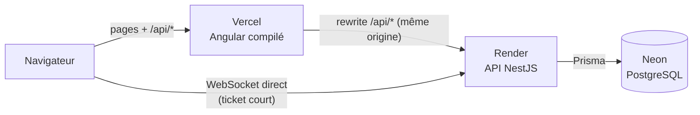
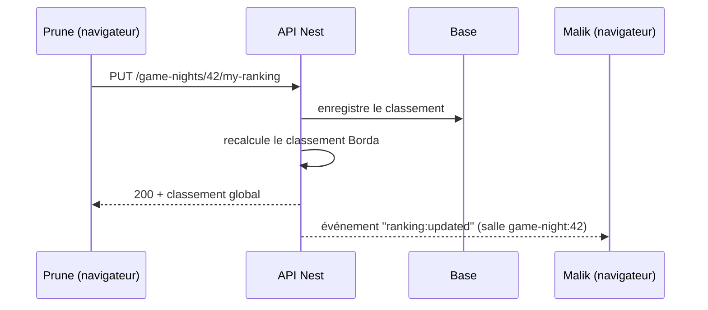

# Architecture : Tablée

> Version 1.0, du 20/11/2026. Statut : **validé**.
> Ce document s'appuie sur le [cahier des charges](cahier-des-charges.md). Les choix y sont expliqués, avec des parallèles avec Vue et React.

---

## 1. Vue d'ensemble



| Brique            | Rôle                                            | Hébergement                 |
| ----------------- | ----------------------------------------------- | --------------------------- |
| `apps/web`        | Angular : l'interface                           | Vercel (fichiers statiques) |
| `apps/api`        | NestJS : API REST et passerelle WebSocket       | Render                      |
| `packages/shared` | Types et constantes communs au front et à l'API | compilé, pas déployé seul   |
| Base              | PostgreSQL                                      | Neon                        |

Le front n'a **pas de rendu serveur** (SSR). Tout est derrière une connexion, donc le référencement ne compte pas, et on évite une couche de complexité.

---

## 2. Le monorepo

```
tablee/
├─ apps/
│  ├─ web/                  Angular
│  └─ api/                  NestJS + Prisma
├─ packages/
│  └─ shared/               types des échanges API, constantes (points Borda, catégories…)
├─ e2e/                     tests Playwright (front + API ensemble)
├─ docs/                    cahier des charges, architecture, décisions, DA
├─ .github/workflows/ci.yml
├─ .nvmrc                   Node 24 (LTS)
└─ package.json             workspaces npm + scripts globaux
```

**Workspaces npm.** C'est la fonction native de npm pour gérer plusieurs paquets dans un seul dépôt. Un seul `npm install` à la racine, et `apps/web` peut importer `@tablee/shared` comme un paquet normal. Pas besoin d'outil en plus (Nx, Turborepo).

**Pourquoi un paquet `shared` ?** Le front et l'API s'échangent des objets (`GameNight`, `VoteRanking`…). Si les deux ont leur propre définition, elles finissent par diverger sans que TypeScript ne le voie. Avec une définition commune, modifier un champ casse la compilation des deux côtés : on voit l'erreur avant de lancer l'appli.

Ce paquet ne contient **que des types et quelques constantes**, sans aucune logique ni dépendance. Il est compilé avec `tsc` avant les deux applis.

---

## 3. Le front : Angular

### 3.1 Angular pour une développeuse Vue / React

| Notion             | Vue 3            | React            | Angular (moderne)                  |
| ------------------ | ---------------- | ---------------- | ---------------------------------- |
| Composant          | SFC `.vue`       | fonction `.tsx`  | classe `@Component` + gabarit HTML |
| État local         | `ref()`          | `useState`       | `signal()`                         |
| Valeur dérivée     | `computed()`     | `useMemo`        | `computed()`                       |
| Effet de bord      | `watchEffect()`  | `useEffect`      | `effect()`                         |
| Propriétés reçues  | `defineProps`    | props            | `input()`                          |
| Événements émis    | `defineEmits`    | callback en prop | `output()`                         |
| Logique partagée   | composable       | hook             | **service** injecté                |
| Condition / boucle | `v-if` / `v-for` | `&&` / `.map()`  | `@if` / `@for`                     |
| Garde de route     | `beforeEnter`    | loader / wrapper | `canActivate` (fonction)           |

La grande différence est l'**injection de dépendances**. Un service Angular, c'est un composable Vue dont Angular crée et partage lui-même l'instance. On le récupère avec `inject(AuthService)`, n'importe où. C'est l'équivalent de `provide` / `inject` en Vue, mais utilisé partout.

Les **signals** rendent Angular très proche de Vue 3 : `signal`, `computed` et `effect` fonctionnent comme `ref`, `computed` et `watchEffect`. Les versions récentes d'Angular fonctionnent sans _zone.js_ : l'écran se met à jour quand un signal change, comme en Vue.

### 3.2 Organisation par fonctionnalité

```
apps/web/src/app/
├─ core/                    chargé une fois : auth, intercepteur HTTP, mise en page, erreurs
├─ ui/                      composants de la DA : bouton, fiche, puce, jeton, champ…
└─ features/
   ├─ auth/                 connexion, inscription
   ├─ tablees/              liste, création, réglages, page « rejoindre »
   ├─ ludotheque/
   ├─ soirees/              liste, création, sondage
   ├─ vote/                 classement + temps réel
   └─ parties/              saisie, historique, statistiques
```

Chaque fonctionnalité contient ses pages, son service et ses routes. Les routes sont **chargées à la demande** (`loadComponent`) : le code du vote n'est téléchargé que si on ouvre un vote.

### 3.3 Gestion de l'état : des services à signals, sans NgRx

Chaque domaine a un service qui garde son état dans des signals, et l'expose en lecture seule. C'est le rôle d'un _store_ Pinia, sans la librairie.

```ts
@Injectable({ providedIn: 'root' })
export class GameNightService {
  private readonly http = inject(HttpClient);
  private readonly _current = signal<GameNight | null>(null);
  readonly current = this._current.asReadonly();
  readonly isOrganizer = computed(() => this._current()?.organizerId === this.auth.userId());
  // …
}
```

NgRx est l'équivalent de Redux. Il sert pour de gros états partagés entre de nombreux écrans, ce qui n'est pas le cas ici.

### 3.4 Formulaires, glisser-déposer, styles

- **Formulaires réactifs typés** (`FormGroup<{ email: FormControl<string> }>`) : TypeScript connaît la forme exacte des valeurs.
- **CDK Drag & Drop** pour le classement, avec les boutons « monter » et « descendre » prévus pour le clavier.
- **CSS maison**, sans Angular Material ni Tailwind. Les jetons du livret de DA deviennent des variables CSS globales (`--papier`, `--sapin`…). Chaque composant a ses styles isolés (l'équivalent de `<style scoped>` en Vue). Material imposerait son propre look, très éloigné de la DA.

### 3.5 Tests

- **Unitaires** : avec le lanceur par défaut de la version d'Angular installée (Vitest sur les versions récentes).
- On teste surtout les services et les composants qui contiennent de la logique (classement, filtres de compatibilité).

---

## 4. L'API : NestJS

### 4.1 NestJS pour une développeuse habituée aux services gérés

Jusqu'ici, Supabase ou Neon faisaient le travail du backend. NestJS est un framework Node qui organise ce travail en briques nettes, avec la même injection de dépendances qu'Angular (c'est voulu, il s'en inspire).

| Brique Nest              | Rôle                                         | Équivalent connu                  |
| ------------------------ | -------------------------------------------- | --------------------------------- |
| **Module**               | regroupe un domaine (ex. `GamesModule`)      | un dossier de fonctionnalité      |
| **Controller**           | reçoit les requêtes HTTP, déclare les routes | une route API de Next.js          |
| **Service** (_provider_) | la logique métier et l'accès à la base       | les fonctions côté serveur        |
| **DTO + ValidationPipe** | valide le corps de chaque requête            | un schéma zod                     |
| **Guard**                | autorise ou refuse une requête               | un middleware d'authentification  |
| **Gateway**              | la connexion WebSocket                       | Supabase Realtime, fait à la main |

### 4.2 Modules

```
apps/api/src/
├─ prisma/                  PrismaService (connexion unique à la base)
├─ auth/                    inscription, connexion, sessions, ticket WebSocket
├─ tablees/                 tablées, membres, invitations
├─ games/                   ludothèque
├─ game-nights/             soirées, créneaux, réponses
├─ votes/                   classements + gateway temps réel
├─ plays/                   parties, résultats, statistiques
└─ common/                  guards, décorateurs, filtres d'erreurs
```

### 4.3 Les routes REST (extrait)

| Méthode        | Route                                            | Qui          |
| -------------- | ------------------------------------------------ | ------------ |
| `POST`         | `/auth/register`, `/auth/login`, `/auth/logout`  | tous         |
| `GET`          | `/auth/me`                                       | connecté     |
| `POST`         | `/tablees`                                       | connecté     |
| `POST`         | `/tablees/join/:code`                            | connecté     |
| `POST`         | `/tablees/:id/invite-code` (régénère)            | hôte         |
| `GET` / `POST` | `/me/games`                                      | connecté     |
| `GET`          | `/tablees/:id/games`                             | membre       |
| `POST`         | `/tablees/:id/game-nights`                       | membre       |
| `PUT`          | `/game-nights/:id/slots/:slotId/response`        | membre       |
| `POST`         | `/game-nights/:id/confirm`                       | organisateur |
| `GET`          | `/game-nights/:id/candidates` (jeux compatibles) | participant  |
| `PUT`          | `/game-nights/:id/my-ranking`                    | participant  |
| `POST`         | `/tablees/:id/plays`                             | membre       |
| `GET`          | `/tablees/:id/stats`                             | membre       |

### 4.4 Les permissions

Trois guards, appliqués par décorateur sur chaque route :

1. `SessionGuard`, **global** : toute route exige une session, sauf celles marquées `@Public()`.
2. `MemberGuard` : vérifie que l'utilisateur appartient à la tablée concernée.
3. `HostGuard` : vérifie le rôle d'hôte.

La règle « organisateur de la soirée » reste dans le service, car elle dépend de la soirée chargée.

---

## 5. Authentification

### 5.1 Sessions en base plutôt que JWT

Le brief prévoyait un JWT. Je propose plutôt une **session stockée en base** :

1. À la connexion, l'API crée une ligne `Session` (un identifiant aléatoire, une date d'expiration à 7 jours).
2. Elle envoie cet identifiant dans un cookie `httpOnly`, `Secure`, `SameSite=Lax`.
3. À chaque requête, le guard retrouve la session en base.

**Pourquoi ?** Un JWT sert surtout quand plusieurs serveurs doivent vérifier une identité sans partager de base. Ici, il n'y a qu'une API et une base. La session en base est plus simple et, surtout, **révocable** : la déconnexion supprime vraiment la session. Un JWT reste valide jusqu'à son expiration, même après la déconnexion. C'est un argument solide en entretien.

Le JWT garde une utilité, mais pour le **ticket WebSocket** uniquement (§ 6.2).

### 5.2 Le problème des cookies entre Vercel et Render

Le front est sur `tablee-jeux.vercel.app`, l'API sur `*.onrender.com` : deux sites différents. Safari et d'autres navigateurs bloquent les cookies envoyés d'un site à l'autre.

**Solution : un proxy Vercel.** `apps/web/vercel.json` redirige `/api/*` vers l'API :

```json
{
  "rewrites": [{ "source": "/api/:path*", "destination": "https://tablee-api.onrender.com/:path*" }]
}
```

Pour le navigateur, tout vient de `tablee-jeux.vercel.app`. Le cookie est « maison » et n'est jamais bloqué. En local, le serveur de développement Angular joue le même rôle grâce à `proxy.conf.json`.

### 5.3 Autres protections

- Mots de passe hachés avec **argon2**.
- **CSRF** : `SameSite=Lax`, plus une vérification de l'en-tête `Origin` sur les requêtes qui modifient des données.
- **Limitation des tentatives** sur la connexion et l'inscription (`@nestjs/throttler`).
- Messages d'erreur génériques à la connexion.

---

## 6. Temps réel

### 6.1 Principe : on écrit en REST, on écoute en WebSocket



Le vote passe par une requête REST classique : validation, permissions et tests restent les mêmes que partout ailleurs. Le WebSocket ne sert **qu'à prévenir** les autres participants. Si la connexion temps réel tombe, rien n'est perdu : à la reconnexion, le front recharge le classement en REST.

**Bibliothèque : Socket.IO**, intégrée à NestJS (`@nestjs/platform-socket.io`). Elle gère les salles (une par soirée) et la reconnexion automatique. Il faudrait recoder les deux avec le WebSocket natif.

### 6.2 L'authentification du WebSocket

Les _rewrites_ de Vercel ne transmettent pas les WebSockets. Le navigateur se connecte donc **directement** à Render, et le cookie de session ne suit pas.

1. Le front demande `GET /api/realtime/ticket` (via le proxy, donc avec le cookie).
2. L'API renvoie un **JWT valable 60 secondes**, qui contient l'identifiant de l'utilisateur.
3. Le front ouvre le socket avec ce ticket ; l'API le vérifie, puis place le client dans la salle de la soirée, après avoir vérifié qu'il y participe.

### 6.3 Côté Angular

Un `RealtimeService` enveloppe `socket.io-client` et expose les événements sous forme de signals. Le composant de vote se contente de lire `ranking()`.

---

## 7. Base de données

### 7.1 Outils

- **Prisma** : on décrit le schéma dans `schema.prisma`, Prisma génère les migrations SQL et un client typé. C'est l'équivalent de ce que tu as fait avec Neon, avec un schéma versionné dans le dépôt.
- **Neon**, avec une branche par environnement : `main` (production) et `dev` (local).
- **CI** : un PostgreSQL éphémère dans GitHub Actions (conteneur de service). Les tests ne touchent jamais Neon.

### 7.2 Langue du code

Le code est en **anglais**, l'interface en français. Exception : `Tablee` reste tel quel, c'est le nom du produit.

| Interface  | Code           |
| ---------- | -------------- |
| Tablée     | `Tablee`       |
| Membre     | `Membership`   |
| Jeu        | `Game`         |
| Soirée     | `GameNight`    |
| Créneau    | `Slot`         |
| Réponse    | `Availability` |
| Classement | `Ranking`      |
| Partie     | `Play`         |
| Résultat   | `PlayResult`   |

### 7.3 Schéma Prisma (ébauche)

Par souci de lisibilité, certaines relations vers `User` ne figurent pas ici (organisateur, auteur, votant, joueur). Elles seront ajoutées dans le vrai fichier.

```prisma
model User {
  id           String       @id @default(cuid())
  email        String       @unique            // stocké en minuscules
  displayName  String
  passwordHash String
  createdAt    DateTime     @default(now())
  sessions     Session[]
  memberships  Membership[]
  games        Game[]
}

model Session {
  id        String   @id                       // aléatoire, 32 octets
  userId    String
  user      User     @relation(fields: [userId], references: [id], onDelete: Cascade)
  expiresAt DateTime
  @@index([userId])
}

model Tablee {
  id          String       @id @default(cuid())
  name        String
  emblem      String                            // couleur ou motif
  inviteCode  String       @unique
  createdAt   DateTime     @default(now())
  memberships Membership[]
  gameNights  GameNight[]
  plays       Play[]
}

enum Role { HOST MEMBER }

model Membership {
  userId   String
  tableeId String
  role     Role     @default(MEMBER)
  joinedAt DateTime @default(now())
  user     User     @relation(fields: [userId], references: [id], onDelete: Cascade)
  tablee   Tablee   @relation(fields: [tableeId], references: [id], onDelete: Cascade)
  @@id([userId, tableeId])
}

enum GameCategory { PARTY STRATEGY FAMILY MYSTERY RPG OTHER }
enum GameMode { COMPETITIVE COOPERATIVE }

model Game {
  id         String       @id @default(cuid())
  ownerId    String
  owner      User         @relation(fields: [ownerId], references: [id], onDelete: Cascade)
  name       String
  minPlayers Int
  maxPlayers Int
  duration   Int                                // minutes
  category   GameCategory
  mode       GameMode
  plays      Play[]
  rankings   RankingEntry[]
}

enum GameNightStatus { POLLING CONFIRMED GAMES_CHOSEN CANCELLED }

model GameNight {
  id             String          @id @default(cuid())
  tableeId       String
  tablee         Tablee          @relation(fields: [tableeId], references: [id], onDelete: Cascade)
  organizerId    String
  title          String
  availableTime  Int                            // minutes
  status         GameNightStatus @default(POLLING)
  chosenSlotId   String?         @unique
  slots          Slot[]          @relation("slots")
  chosenSlot     Slot?           @relation("chosen", fields: [chosenSlotId], references: [id])
  rankings       RankingEntry[]
  plays          Play[]
}

model Slot {
  id             String         @id @default(cuid())
  gameNightId    String
  gameNight      GameNight      @relation("slots", fields: [gameNightId], references: [id], onDelete: Cascade)
  startsAt       DateTime
  availabilities Availability[]
  chosenFor      GameNight?     @relation("chosen")
}

enum Answer { YES MAYBE NO }

model Availability {
  slotId String
  userId String
  answer Answer
  slot   Slot   @relation(fields: [slotId], references: [id], onDelete: Cascade)
  @@id([slotId, userId])
}

model RankingEntry {
  gameNightId String
  userId      String
  gameId      String
  rank        Int                               // 1 à 5
  gameNight   GameNight @relation(fields: [gameNightId], references: [id], onDelete: Cascade)
  game        Game      @relation(fields: [gameId], references: [id], onDelete: Cascade)
  @@id([gameNightId, userId, rank])
  @@unique([gameNightId, userId, gameId])
}

model Play {
  id          String       @id @default(cuid())
  tableeId    String
  tablee      Tablee       @relation(fields: [tableeId], references: [id], onDelete: Cascade)
  gameId      String?
  game        Game?        @relation(fields: [gameId], references: [id], onDelete: SetNull)
  gameName    String                            // copie du nom, si le jeu est supprimé
  gameMode    GameMode
  gameNightId String?
  gameNight   GameNight?   @relation(fields: [gameNightId], references: [id], onDelete: SetNull)
  playedAt    DateTime
  authorId    String
  coopWon     Boolean?                          // uniquement en mode coopératif
  results     PlayResult[]
}

model PlayResult {
  playId String
  userId String
  isWinner Boolean @default(false)
  score    Int?
  play     Play    @relation(fields: [playId], references: [id], onDelete: Cascade)
  @@id([playId, userId])
}
```

**Deux choix à noter :**

- **Les participants ne sont pas stockés.** Ce sont les réponses `YES` au créneau retenu. Une seule source de vérité, pas de désynchronisation possible.
- **Une partie garde le nom du jeu** (`gameName`). Si le propriétaire supprime le jeu, l'historique reste lisible.

---

## 8. Environnements et configuration

|       | Local                            | CI                       | Production           |
| ----- | -------------------------------- | ------------------------ | -------------------- |
| Front | `ng serve` (port 4200) + proxy   | build                    | Vercel               |
| API   | `nest start --watch` (port 3000) | démarrée pour Playwright | Render               |
| Base  | Neon, branche `dev`              | PostgreSQL éphémère      | Neon, branche `main` |

Variables d'environnement de l'API, validées au démarrage (l'API refuse de démarrer s'il en manque une) :
`DATABASE_URL`, `SESSION_SECRET`, `REALTIME_JWT_SECRET`, `WEB_ORIGIN`.

**Render, offre gratuite :** l'API se met en veille après 15 minutes d'inactivité, et le premier appel prend alors environ 50 secondes. Pour un projet de portfolio, c'est acceptable si l'interface l'assume : un écran d'attente aux couleurs de la DA (« On installe la table… ») plutôt qu'une page blanche.

---

## 9. Qualité et CI

Un seul workflow GitHub Actions, à chaque push et pull request :

1. `npm ci`
2. **lint** (ESLint, avec les règles Angular côté front)
3. **types** : `tsc --noEmit` sur les trois paquets
4. **tests unitaires** : front et API
5. **tests d'intégration de l'API** : Supertest, sur le PostgreSQL éphémère
6. **Playwright** : front et API démarrés, sur les parcours clés

Prettier formate le code ; TypeScript est en mode `strict` partout.

---

## 10. Ce qu'on n'utilise pas, et pourquoi

| Outil                      | Raison                                           |
| -------------------------- | ------------------------------------------------ |
| Nx, Turborepo              | les workspaces npm suffisent pour trois paquets  |
| SSR Angular                | appli derrière connexion, pas de référencement   |
| NgRx                       | services à signals suffisants                    |
| Angular Material, Tailwind | DA sur mesure, CSS maison                        |
| JWT pour les sessions      | sessions en base, révocables (§ 5.1)             |
| GraphQL                    | REST suffit, et c'est l'objectif d'apprentissage |
| Docker en local            | Neon fournit déjà une base de dev                |

---

## 11. Points validés le 20/11/2026

1. **Sessions en base** au lieu d'un JWT pour l'authentification (le JWT ne sert qu'au ticket WebSocket).
2. **Proxy Vercel** pour l'API, et WebSocket direct avec ticket.
3. ✅ **Render gratuit**, avec un écran d'attente pour la mise en veille. Validé le 20/11/2026 ; on décidera à l'étape 8 s'il faut passer à une offre payante (environ 6 $ par mois, sans mise en veille).
4. **Code en anglais**, interface en français.
5. **Socket.IO** pour le temps réel.
6. **CSS maison**, sans librairie de composants.
